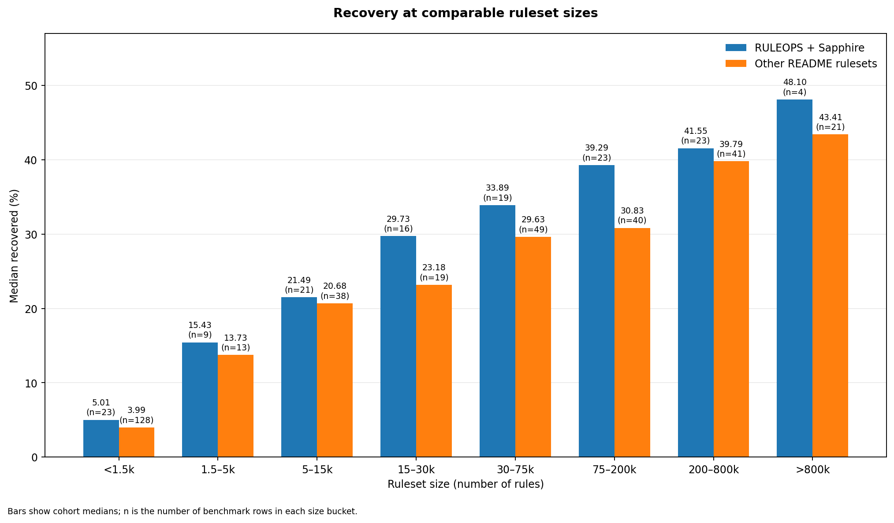
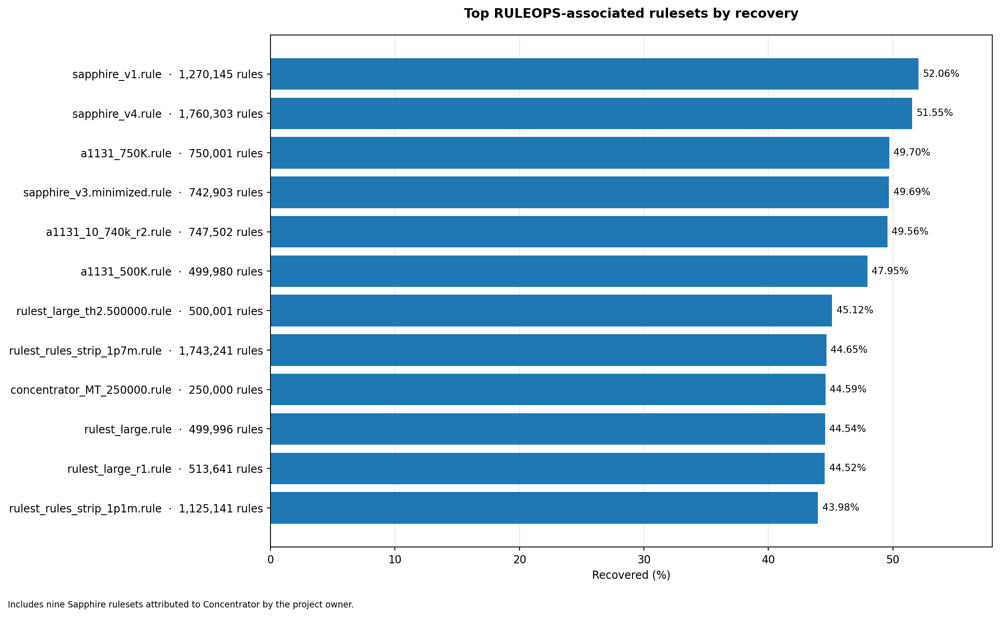
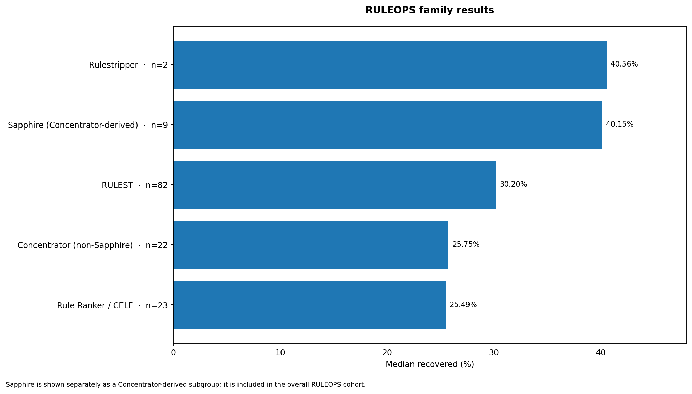
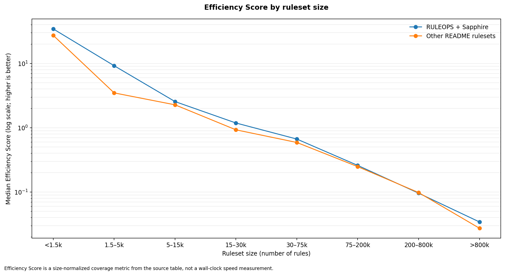

# RULEOPS Ruleset Quality Benchmark

> [← Documentation index](../README.md)

**Benchmark date:** 2026-11-25  
**Source revision:** [`A113L/hashcat-rules-comparison@cc99ee6`](https://github.com/A113L/hashcat-rules-comparison/commit/cc99ee6a69b767b0991ebdb17ba8b3870bfbbb72)  
**Analysis prepared with:** **OpenAI GPT-6**.

## Executive summary

This report compares the recovery results of rulesets attributed to RULEOPS with the remaining rulesets in the same published Hashcat rules benchmark. It evaluates **ruleset outcomes**—recovered percentage, ruleset size, reported average crack rate and the source Efficiency Score. It does **not** benchmark RULEOPS application runtime, GPU kernel speed, or the time required to generate a ruleset.

The RULEOPS cohort contains **138 benchmark rows**: 129 rows documented in `RULEOPS_RULES.md`, plus nine Sapphire variants. The Sapphire variants are included because the project owner confirmed that they were obtained through Concentrator and debugged. The comparison cohort contains **349 README rows** after excluding the 51 ruleset names already represented in the RULEOPS catalog and the nine Sapphire rows. This avoids comparing a RULEOPS entry against itself.

| Metric | RULEOPS + Sapphire | Other README rulesets |
|---|---:|---:|
| Benchmark rows | **138** | 349 |
| Unique rule names | 137 | 345 |
| Median recovered | **30.20%** | 14.66% |
| Mean recovered | **28.08%** | 18.36% |
| Median ruleset size | 39,133 | 11,721 |
| Median reported crack rate (/h) | 7,879.84 | 4,308.60 |
| Median Efficiency Score | 0.7350 | 0.8540 |

The overall medians are affected by different ruleset-size distributions, so the main comparison is the size-stratified analysis below. At comparable ruleset sizes, the RULEOPS cohort has a higher median recovery in **all eight** size buckets. The largest median gaps are in the 75k–200k bucket (+8.46 percentage points) and the 15k–30k bucket (+6.55 pp).

## 1. Scope and attribution

The benchmark sources are the two Markdown tables in the comparison repository:

- [`README.md`](https://github.com/A113L/hashcat-rules-comparison/blob/cc99ee6a69b767b0991ebdb17ba8b3870bfbbb72/README.md) — the overall benchmark table.
- [`RULEOPS_RULES.md`](https://github.com/A113L/hashcat-rules-comparison/blob/cc99ee6a69b767b0991ebdb17ba8b3870bfbbb72/RULEOPS_RULES.md) — the RULEOPS ruleset catalog and its tool-family notes.

The RULEOPS family mapping follows the catalog's descriptions:

- `rulest_*` and `rulest.*` → RULEST.
- `ranker_*`, `a1131_*` base variants and `heaped_*` → Rule Ranker / CELF.
- `a1131_*r2`, `a1131_Gen*` and `concentrator_*` → Concentrator-related output.
- `rulestripper_*` → Rulestripper.
- `sapphire*` → **Concentrator-derived and debugged**, based on project-owner clarification for this report.

Sapphire is displayed as its own subgroup in the family chart, but it is included in the overall RULEOPS cohort and in the size-matched comparisons. It is not counted as an external competitor. The current `RULEOPS_RULES.md` family legend does not yet explicitly list Sapphire; its attribution here is based on the project-owner clarification.

Rows not identified by the published RULEOPS catalog or the Sapphire clarification remain in the comparison cohort. No additional provenance is inferred from a filename alone.

## 2. Recovery at comparable ruleset sizes

The table below groups each ruleset by its `Rules Count`. Values are **medians within each bucket**, not paired tests of two files. `n` is the number of benchmark rows in that bucket.

| Ruleset size | RULEOPS n | Other n | RULEOPS median recovery | Other median recovery | Difference |
|---|---:|---:|---:|---:|---:|
| <1.5k | 23 | 128 | **5.01%** | 3.99% | **+1.02 pp** |
| 1.5k–5k | 9 | 13 | **15.43%** | 13.73% | **+1.70 pp** |
| 5k–15k | 21 | 38 | **21.49%** | 20.68% | **+0.81 pp** |
| 15k–30k | 16 | 19 | **29.73%** | 23.18% | **+6.55 pp** |
| 30k–75k | 19 | 49 | **33.89%** | 29.63% | **+4.26 pp** |
| 75k–200k | 23 | 40 | **39.29%** | 30.83% | **+8.46 pp** |
| 200k–800k | 23 | 41 | **41.55%** | 39.79% | **+1.76 pp** |
| >800k | 4 | 21 | **48.10%** | 43.41% | **+4.69 pp** |

The direction is consistent across the eight buckets: the RULEOPS-associated cohort has the higher median recovery in every bucket. The >800k result has a small RULEOPS sample (`n=4`), so it should be treated as suggestive rather than conclusive. The 75k–200k and 15k–30k buckets show the largest median gaps.

## 3. Strongest RULEOPS-associated rulesets

The following chart shows the 12 highest-recovery entries in the combined RULEOPS + Sapphire cohort. Sapphire entries are included because of their Concentrator provenance.

| Ruleset | Recovered | Rules count |
|---|---:|---:|
| `sapphire_v1.rule` | **52.06%** | 1,270,145 |
| `sapphire_v4.rule` | **51.55%** | 1,760,303 |
| `a1131_750K.rule` | **49.70%** | 750,001 |
| `sapphire_v3.minimized.rule` | **49.69%** | 742,903 |
| `a1131_10_740k_r2.rule` | **49.56%** | 747,502 |
| `a1131_500K.rule` | **47.95%** | 499,980 |
| `rulest_large_th2.500000.rule` | **45.12%** | 500,001 |
| `rulest_rules_strip_1p7m.rule` | **44.65%** | 1,743,241 |
| `concentrator_MT_250000.rule` | **44.59%** | 250,000 |
| `rulest_large.rule` | **44.54%** | 499,996 |
| `rulest_large_r1.rule` | **44.52%** | 513,641 |
| `rulest_rules_strip_1p1m.rule` | **43.98%** | 1,125,141 |

The top absolute recovery values in the external comparison cohort are still higher: `Fordyv4a.rule` (56.94%, 4,003,430 rules), `Fordyv4b.rule` (56.28%, 6,901,692 rules), and `Fordyv3-2Mil.rule` (54.53%, 1,999,904 rules). They are also substantially larger than most RULEOPS entries. `A1131.3M.rule` remains in the external cohort because it is not listed in the RULEOPS catalog used for attribution in this analysis; it can be reclassified if its provenance is confirmed.

## 4. Results by RULEOPS tool family

The family breakdown below uses the catalog's attribution notes. Sapphire is separated for visibility but included in the overall Concentrator-derived total.

| Family | Rows | Median recovery | Mean recovery | Median rules count | Median reported crack rate (/h) | Median Efficiency Score |
|---|---:|---:|---:|---:|---:|---:|
| RULEST (`rulest_*`, `rulest.*`) | 82 | **30.20%** | 28.32% | 50,001 | 7,353.71 | 0.6723 |
| Rule Ranker / CELF | 23 | 25.49% | 24.84% | 10,001 | 3,583.00 | 2.2948 |
| Concentrator, excluding Sapphire | 22 | 25.75% | 25.34% | 11,938 | 15,380.00 | 2.1910 |
| Sapphire (Concentrator-derived) | 9 | **40.15%** | 38.21% | 100,000 | 8,641.00 | 0.4015 |
| Rulestripper | 2 | 40.56% | 40.56% | 621,678 | 2,065.64 | 0.0658 |

The combined Concentrator-derived family (22 catalogued Concentrator/R2/Gen rows plus nine Sapphire rows) contains **31 rows**, with a median recovery of **31.08%**. Rulestripper's median is the highest family median, but it is based on only two entries and both are large rulesets; that small sample should not be used to rank the tool conclusively.

## 5. Efficiency Score and reported crack rate

The README includes `AVG Crack Rate (/h)` and `Efficiency Score`:

- `AVG Crack Rate (/h)` is copied as published. Its values depend on the benchmark environment and the measured ruleset/workload; the repository does not provide enough per-run hardware and configuration detail to treat them as a controlled hardware-normalized speed comparison.
- The published Efficiency Score is consistent with `Recovered (%) × 1,000 / Rules Count` (allowing for displayed rounding). It is therefore a **coverage-per-rule score**, not a wall-clock runtime or GPU-throughput metric.

The source Efficiency Score's median is affected by ruleset-size distribution. In size-matched buckets, the RULEOPS cohort has a higher median score in seven of eight buckets; the 200k–800k bucket is marginally lower (0.0959 vs 0.0980). The other seven buckets favor RULEOPS.

## 6. Sapphire results

All nine Sapphire variants present in the README were classified as Concentrator-derived and debugged, following the project owner's clarification. Their median recovery is **40.15%**, with a mean of **38.21%**.

| Sapphire ruleset | Recovered | Rules count | Avg crack rate (/h) | Efficiency Score |
|---|---:|---:|---:|---:|
| `sapphire_v1.rule` | 52.06% | 1,270,145 | 1,502.40 | 0.0410 |
| `sapphire_v4.rule` | 51.55% | 1,760,303 | 1,066.84 | 0.0293 |
| `sapphire_v3.minimized.rule` | 49.69% | 742,903 | 2,192.21 | 0.0669 |
| `sapphire_v2.rule` | 43.98% | 250,001 | 5,854.54 | 0.1759 |
| `sapphire_large.rule` | 40.15% | 100,000 | 16,398.55 | 0.4015 |
| `sapphire_medium.rule` | 36.14% | 50,000 | 30,294.12 | 0.7228 |
| `sapphire.optimized.rule` | 35.99% | 64,870 | 17,584.67 | 0.5548 |
| `sapphire_small.rule` | 25.50% | 10,000 | 28,257.00 | 2.5500 |
| `sapphire_tiny.rule` | 8.80% | 250 | 8,641.00 | 34.4000 |

## 7. Interpretation

The published results support the following conclusions:

1. **RULEOPS is especially competitive in small and medium rulesets.** After matching rulesets by count, its cohort has a higher median recovery in all eight size buckets.
2. **The strongest size-matched advantage appears around 75k–200k rules.** The median gap is +8.46 percentage points in this bucket.
3. **Sapphire materially changes the attribution picture.** Treating Sapphire as external would understate the Concentrator-derived results and incorrectly classify nine project-produced rulesets as competitors.
4. **The largest external rulesets still post the highest individual recovery values.** Their multi-million-rule sizes are not directly comparable to the smaller RULEOPS entries without considering budget.
5. **Family-level rankings need sample-size context.** For example, Rulestripper has only two rows, while RULEST has 82.

## 8. Limitations and reproducibility

- This is an analysis of published benchmark tables, not a newly executed Hashcat campaign. No new password data was generated or tested as part of this report.
- The repository describes the benchmark wordlist as `hashmob.medium.found` and notes 367 finds without rules. It does not publish a complete per-row manifest of GPU model, driver, Hashcat build, command line, run duration, or repeat count. Do not interpret crack-rate differences as controlled performance measurements.
- The README contains four repeated filenames with different metrics (`ultra.rule`, `simple_additive.rule`, `simple_number-only.rule`, and `best64.rule`). The RULEOPS catalog contains one repeated filename with two different metric rows (`rulest_medium.th2.new_op.150000.rule`). Both rows are retained because the source does not explain which observation supersedes the other.
- The merged comparison consists of 138 RULEOPS-associated rows and 349 external rows. It includes catalog entries absent from the general README, while removing matching names and Sapphire from the external group to avoid self-comparison and attribution errors.
- The overall median compares groups with different size distributions; use the size-bucket table for the fairer comparison. Bucket medians remain descriptive and are not paired comparisons.
- The >800k bucket contains four RULEOPS-associated rows; its median is sensitive to individual entries.
- Sapphire provenance is included based on the project-owner clarification for this report and should be added to the upstream family legend if the project wants that attribution reflected there permanently.

### Source files

- [Benchmark README at pinned commit](https://github.com/A113L/hashcat-rules-comparison/blob/cc99ee6a69b767b0991ebdb17ba8b3870bfbbb72/README.md)
- [RULEOPS rules catalog at pinned commit](https://github.com/A113L/hashcat-rules-comparison/blob/cc99ee6a69b767b0991ebdb17ba8b3870bfbbb72/RULEOPS_RULES.md)
- [Pinned source commit](https://github.com/A113L/hashcat-rules-comparison/commit/cc99ee6a69b767b0991ebdb17ba8b3870bfbbb72)
- [Chart summary data (CSV)](../assets/ruleset-benchmark-summary.csv)

---

**Prepared by OpenAI GPT-6**  

